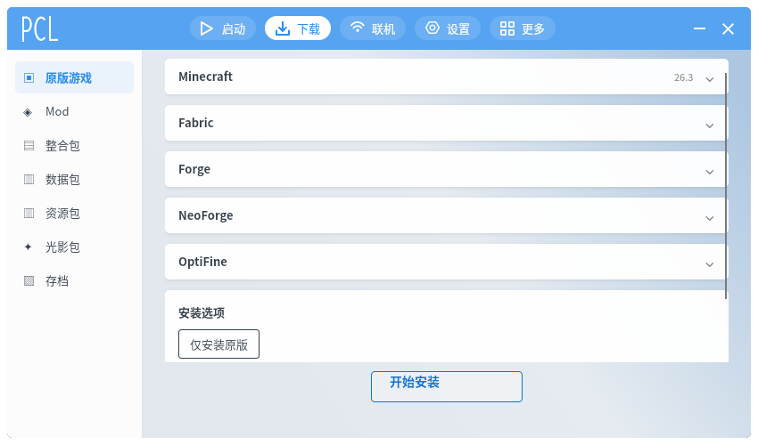

# 下载页与 PCL-CE / PCL-ME 技术评估审计

日期：2026-10-19

## 0. 审计结论（原始状态）

审计时，这个页面不是 PCL2 的“下载 → 原版游戏”结构，而是把三种东西拼在了一起：

1. 一个大的“Minecraft 下载表单”；
2. 三张加载器“单独安装”卡；
3. 一个额外的“组合安装”表单和底部按钮。

滚动修复只是让顶部卡片不再被裁掉，**不代表页面还原了**。

> 2026-10-19 更新：已完成 P0 重构，见下方“P0 执行结果”。原始对照保留作审计记录。

### P0 执行结果（2026-10-19）

已按审计建议执行第一轮重构：

- Minecraft 改为 **40px 收起卡片**，点击展开版本选择/校验；
- 删除页面内“全部/已安装/正式版/快照”筛选 ComboBox；
- 删除 Fabric / Forge / OptiFine 独立安装卡和它们各自的安装按钮；
- 删除单独的“安装设置”重复表单；
- 统一为一个“安装组件”卡：
  - 基础加载器；
  - 当前加载器版本；
  - OptiFine 附加项；
  - 实例名；
  - 组合进度/状态；
- 底部只保留一个“开始安装”；
- 版本上下文统一使用 `Download.SelectedVersion`；
- 组合安装现在会使用用户选中的 Fabric/Forge/NeoForge 版本，而不是永远取第一个；
- 选择 Fabric/Forge/NeoForge/OptiFine 时自动准备对应版本的加载器列表；
- 新增 `Animation/MotionDurations` 统一动画时长，并给下载页加入 PCL-ME 风格的淡入+上移入场动画。

当前页面截图：`docs/screenshots/wmcl-download-refactor.png`。

仍未完成：
- Minecraft 仍用 ComboBox + 原地展开，不是 PCL2 的独立版本选择页；
- 加载器仍是一个组件卡，不是 PCL2 的多个 40px 组件卡；
- 目前只借了 PCL-ME 的时长 token + 单页入场；`Motion` 的列表交错、弹窗 overshoot、选择条尚未迁移；
- Fabric API / OptiFabric / LiteLoader 等组件未补。

## 1. 当前下载页是什么

当前“下载 → 原版游戏”对应：

- `src/WMCL.App/Views/InstallView.axaml`
- `src/WMCL.App/ViewModels/InstallViewModel.cs`
- `src/WMCL.App/ViewModels/DownloadViewModel.cs`
- `src/WMCL.App/ViewModels/ModsViewModel.cs`

页面实际由四块组成。

### 1.1 Minecraft 卡片

包含：

- 版本下拉：`Download.Versions` / `Download.SelectedVersion`；
- “全部 / 已安装 / 正式版 / 快照”筛选：`Download.Filters`；
- 版本标题、类型、路径；
- “安装所选版本”“校验 / 修复”“取消”；
- 安装进度与状态。

### 1.2 Fabric / Forge / NeoForge / OptiFine 折叠卡

这些是**单独的加载器安装器**：

- Fabric 使用 `Mods.GameVersions`、`Mods.Loaders`；
- Forge/NeoForge 使用 `Mods.ForgelikeKinds`、`Mods.ForgelikeVersions`；
- OptiFine 使用 `Mods.OptiFineVersions`。

它们有自己的 `安装 Fabric`、`安装 Forge/NeoForge`、`安装 OptiFine` 按钮。

### 1.3 “安装设置”卡片

这是**组合安装**：

- `基础加载器`：无 / Fabric / Forge / NeoForge / OptiFine；
- `附加组件`：同时安装 OptiFine；
- `实例名`；
- 底部固定“开始下载”按钮调用 `InstallCombinedCommand`。

组合安装会：

1. 安装原版（如果未安装）；
2. 安装加载器；
3. 可选安装 OptiFine；
4. 通过 `MergedInstanceBuilder` 合并成一个实例；
5. 删除临时源实例。

## 2. 为什么看起来“很怪”

### 2.1 滚动只是次要问题

图片里 Minecraft 标题被滚出视口，确实是页面内部滚动位置；已修：

- 下载页进入时复位 `ScrollViewer`；
- 主窗口切页时统一复位页面滚动。

但**滚动不是主因**。这个页面的控件组织和 PCL2 不是一个东西，见下面的结构对照。

### 2.2 结构问题是真的

当前页面同时存在两套安装模型：

| 模型 | 入口 | 使用的版本状态 | 结果 |
|---|---|---|---|
| 单独安装 | Fabric/Forge/OptiFine 卡片 | `Mods.SelectedGameVersion` | 单独生成/更新加载器实例 |
| 组合安装 | “安装设置” + “开始下载” | `Download.SelectedVersion` | 原版 + 加载器 + OptiFine 合并实例 |

这会导致：

1. **两个版本选择源**
   - 顶部选 `26.3`；
   - 下方 Fabric 卡选 `1.21.1`；
   - 点“安装 Fabric”用的是 1.21.1，点“开始下载”用的是 26.3。
   - 用户无法从界面看出两个状态是分开的。

2. **两个安装按钮体系**
   - 卡片里的单独安装；
   - 底部组合安装。
   - 两者都可能创建/修改实例，边界不清。

3. **筛选器语义不清**
   - “全部”下拉没有标签，视觉上像第二个版本下拉；
   - 筛选会改变 `Download.Versions`，但不改变下方 Mods 版本状态。

4. **折叠卡片标题像输入框**
   - Avalonia 默认 Expander 标题在截图里接近 ComboBox 外观；
   - 收起时看不到选中版本/加载器版本。

5. **“开始下载”文案不准确**
   - 它可能执行原版安装 + 加载器安装 + 实例合并；
   - 不只是一个“下载”。

### 2.3 PCL2 的对应结构

PCL2 `PageDownloadInstall` 的实际结构：

- Minecraft 是 **40px 高的组件卡片**，收起时只显示当前版本摘要；
- Forge / NeoForge / Fabric / Fabric API / OptiFine / OptiFabric / LiteLoader 都是 **40px 高的独立组件卡片**；
- 卡片点击展开选择版本/加载器；
- 卡片本身**没有“安装 Fabric”“安装 Forge”这种单独执行按钮**；
- 页面底部只有一个悬浮的 `BtnStart`「开始下载」；
- 只有一个当前版本上下文；
- 没有当前页面这种“全部/已安装”筛选 ComboBox。

### 2.4 对照表

| 项目 | PCL2 | 当前 WMCL |
|---|---|---|
| Minecraft | 40px 折叠卡片，摘要 + 选择页 | 大表单：版本 ComboBox + 筛选 + 详情 + 安装按钮 |
| 加载器 | 40px 组件卡片，只选择 | 折叠卡 + 各自安装按钮 |
| 安装入口 | 底部唯一“开始下载” | 各卡单独安装 + 底部组合安装 |
| 版本上下文 | 一个 | `Download.SelectedVersion` 与 `Mods.SelectedGameVersion` 两套 |
| 筛选 | 在版本选择页 | 页面内额外 ComboBox，无标签 |
| 实例名 | 选择/命名流程 | “安装设置”里单独输入 |
| 结果 | 组件组合安装 | 两种安装模型都可能创建/修改实例 |

当前页面是“组件卡片 + 单独安装按钮 + 额外组合安装卡片”的混合体，所以看起来重复、跳跃。

### 2.5 具体到截图

- 顶部“全部”不是第二个版本选择，是 `Download.Filters` 的筛选器；
- 下方 Fabric / Forge 行是折叠卡片的标题，不是输入框；
- 底部“开始下载”执行的是组合安装，不是单纯下载；
- 页面里同时有 `安装所选版本`、`安装 Fabric`、`开始下载` 三个执行入口，这是结构错误。

## 3. PCL-CE 技术评估

### 3.1 技术栈

- `PCL.Core/PCL.Core.csproj`：`net10.0-windows`，`UseWPF=true`；
- `Plain Craft Launcher 2/Plain Craft Launcher 2.csproj`：`net10.0-windows`，`UseWPF=true`，WinExe；
- 代码中大量 `System.Windows.*`、WPF `Storyboard`/`AniStart`、Windows DLL：
  - `iphlpapi.dll`
  - `kernel32`
  - WPF 资源与窗口 API。

### 3.2 跨平台情况

README 明确：

- Windows 10 1809+：完整支持；
- macOS / Linux：仅“跨平台开发支持（交叉编译）”，不能直接运行。

结论：

- PCL-CE **不是跨平台 UI**；
- 它的 WPF 控件和动画不能直接搬到 Avalonia；
- 可借鉴的是：
  - 页面结构；
  - `PageStack` 导航；
  - 下载安装页的卡片组织；
  - 本地化资源组织；
  - 不包含 UI 动画代码。

## 4. PCL-ME 技术评估

### 4.1 技术栈

- `PCL.Core.Backend`：`net10.0`；
- `PCL.Frontend.Avalonia`：`net10.0`，Avalonia 11.3.13；
- `PCL.Tools.I18n`：`net10.0`；
- 没有 `-windows` TFM；
- 使用 `Avalonia.Desktop`、`FluentTheme`、编译绑定、内嵌字体；
- 通过 `EnableThemeColorSwitch` 处理非 Windows 主题颜色能力。

### 4.2 跨平台方式

PCL-ME 是真正的 Avalonia 跨平台结构：

- 后端逻辑放在 `PCL.Core.Backend`；
- 前端 UI 与 ViewModel 在 `PCL.Frontend.Avalonia`；
- 桌面入口通过 Avalonia Desktop；
- 没有 WPF/Windows UI 依赖。

这和我们 WMCL 的技术栈一致：

- WMCL：Avalonia 11.3.10 + .NET 10；
- PCL-ME：Avalonia 11.3.13 + .NET 10。

因此 PCL-ME 是**可直接借鉴技术实现**的参考，PCL-CE 主要是功能和结构参考。

### 4.3 动画实现

PCL-ME 的动画不是散落在每个控件里，而是集中在：

- `Desktop/Animation/MotionDurations.cs`
  - 统一时长 token；
  - `RouteTransition`、`EntranceFade/Translate`、`InteractiveState`、`SurfaceState`、`ModalOvershoot/Exit`、`Startup` 等；
  - 可调动画速度。
- `Desktop/Animation/Motion.cs`
  - 附加属性：`AnimateOnVisible`、`StaggerChildren`、`Delay`、`OffsetX/Y`、`InitialOpacity`、`ExitOffsetX/Y`；
  - 页面/列表入场和交错动画。
- `Desktop/Animation/PclModalMotion.cs`
  - Overlay 淡入；
  - Panel `scale(0.94) → 1.035 → 1` 的 overshoot；
  - 关闭 scale 0.97。
- `Desktop/Animation/SelectionBarMotion.cs`
  - 高度和透明度过渡；
  - 选中用 `BackEaseOut`，取消用 `CubicEaseIn`。

控件层面：

- `PclCard.axaml`：Background/BoxShadow 的 `BrushTransition` / `BoxShadowsTransition`；
- `PclButton.axaml`、`PclListItem.axaml`、`PclExtraButton.axaml`：状态过渡；
- `MainWindow.axaml`：页面/窗口过渡。

### 4.4 可以借鉴什么

优先借鉴 **Avalonia 原生模式**：

1. 抽 `MotionDurations` 到 WMCL；
2. 用附加属性实现页面/列表入场，而不是每个页面重复 Animation；
3. 卡片/按钮统一 `Transitions`，而不是控件里各自写；
4. 弹窗使用 `PclModalMotion` 的 overshoot 思路；
5. 侧边选择条使用 `SelectionBarMotion` 的高度/透明度过渡。

不建议照搬：

- PCL-CE 的 WPF Storyboard/AniStart；
- PCL-ME 的 UI 代码整体复制（UI 目录有自定义许可，需先确认授权）；
- 为了动画破坏 PCL2 的固定尺寸和布局。

### 4.5 许可注意

- PCL-ME 根目录是 Apache 2.0，但 `PCL.Frontend.Avalonia/` 使用自定义 UI 许可；
- PCL-CE 的 `Plain Craft Launcher 2/` 也使用自定义许可；
- 只能参考结构和实现思路，不能直接把 UI 文件成段复制进 WMCL。

## 5. 建议的下载页改造

### P0：统一安装模型

选择其中一种，不要并存：

- **方案 A（推荐，贴近 PCL2）**
  - 顶部 Minecraft 卡片负责选版本；
  - Fabric/Forge/NeoForge/OptiFine 卡片只负责勾选/选版本，不提供单独安装按钮；
  - 只保留底部“开始安装”，使用同一个版本上下文；
  - 删除重复的“安装设置”下拉，或把它变成组件勾选摘要。

- **方案 B（更简单）**
  - 移除四张加载器单独安装卡；
  - 只保留顶部 Minecraft + 安装设置 + 底部开始。

无论哪种，必须只有一个 `SelectedVersion` 和一个安装入口。

### P1：统一版本状态

- 顶部 `Download.SelectedVersion` 与 `Mods.SelectedGameVersion` 合并为一个；
- 加载器卡片不再显示自己的“游戏版本”下拉；
- 筛选器增加明确标签“版本筛选”，并说明它只影响版本列表。

### P2：文案与状态

- “开始下载”改为“开始安装”或“安装所选组件”；
- 显示“将安装：原版 26.3 + Fabric”摘要；
- 单独安装和组合安装只保留一个进度/状态区。

### P3：动画

- 先从 PCL-ME 借 `MotionDurations` 和 `AnimateOnVisible`；
- 页面切换、卡片入场、弹窗使用同一套时长；
- 不在下载页加入额外位移动画，避免破坏固定窗口布局。

## 6. 审计结论

- 当前下载页“怪”的根因不是单个控件，而是**两套安装模型并存**；
- 截图顶部被裁切是页面滚动位置问题，已修；
- PCL-CE 是 WPF/Windows-only，不能直接提供跨平台 UI 或动画；
- PCL-ME 是 Avalonia/.NET 10 跨平台实现，技术栈与 WMCL 一致，动画架构可借鉴；
- 下载页应优先统一版本上下文和安装入口，再谈动画。

## 7. 验证与限制

- 已检查本地源码：
  - `pcl2-research/PCL-CE/Plain Craft Launcher 2.csproj`
  - `pcl2-research/PCL-CE/PCL.Core/PCL.Core.csproj`
  - `pcl2-research/PCL-ME/PCL.Frontend.Avalonia/PCL.Frontend.Avalonia.csproj`
  - `pcl2-research/PCL-ME/PCL.Frontend.Avalonia/Desktop/Animation/*.cs`
- WMCL 构建：0 warning / 0 error；测试 142 通过。
- 没有运行 PCL-CE/PCL-ME 做视觉对比，结论基于源码与项目配置。
- 没有在真实鼠标操作下验证折叠卡/筛选器行为；结构问题来自 XAML/ViewModel 绑定关系。
